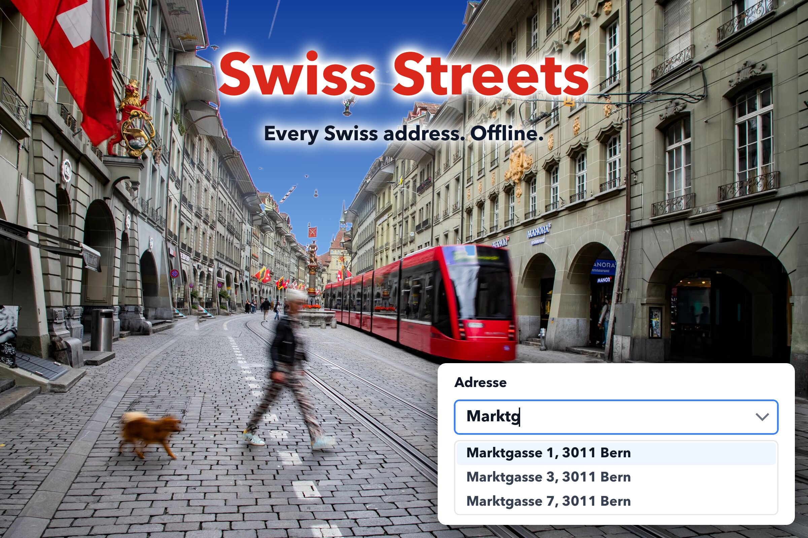

# swissstreets

<span class="filament-hidden">Every Swiss address. Offline. Daily.</span>



[](https://packagist.org/packages/blemli/swissstreets-for-filament) [](https://github.com/blemli/swissstreets-for-filament/actions?query=workflow%3Atests+branch%3Amain) [](https://github.com/blemli/swissstreets-for-filament/actions?query=workflow%3Afix-code-style+branch%3Amain) [](https://packagist.org/packages/blemli/swissstreets-for-filament)

<span class="filament-hidden">Address field for Filament backed by the official [Swiss building address register](https://www.swisstopo.admin.ch/en/official-directory-of-building-addresses). Nightly update from the official source, works fully offline, sorts by vicinity — no spatial extension required. Support for foreign addresses, because life is messy.</span>

## Install (~5min)

```bash
composer require blemli/swissstreets-for-filament
php artisan swissstreets:install
```

The installer will ask you smart questions, otherwise use  `--no-interaction` to stick with the defaults.

> [!TIP]
>
> "Money-Back" Guarantee: Remove everything with `php artisan swissstreets:uninstall`.

## Features

[Dark Mode](#Problemli Baseline), [Mobile Friendly](#Problemli Baseline), [Filament Native Style](#Problemli Baseline), [Fully Offline](#Problemli Baseline), [Fully Translated](#Problemli Baseline), Nightly Update, Notifiy certain Users about Address-Changes,  Dispatches Laravel Events, Fully Fledged Resource Table, Also import planned addresses, Also import unofficial Addresses, Diacritics Safe - fast Dropdown, Vicinity Search without Spatial SQL, Single Field Mode or Multiple Field Mode, LV95 and WGS84, Allow Foreign/Custom Addresses, Map Picker, Reverse Geocoding, Custom Validation Rule, Allow Users to force a fresh import, Use without filament, Exclude Addresses from Backup, Support Table- and Global Search, Comprehensive Uninstaller, Artisan Command for importing, Worst Case URL Override, Logging, Scopes, and much more...

Translations: DE, FR, IT, EN
Supported Third Parties: 

## Contributions

Any Kind of input is highly appreciated! Short Bugreports, Improvement Ideas, Pull-Requests, Translations. Anything that makes you still do work after installing this plugin shall be eliminated. I want this package to be maximally solid and useful to developers and users! LLMs are welcome. 

## Use

### Panel Configuration

```php
->plugin(SwissstreetsPlugin::make()
         ->cantons(['BS', 'BL']) //only import certain Cantons
         ->withoutCantons(['ZH']) //because no one likes Zurich :)
         ->table(navigationicon: , navigationLabel, navigationGroup, guard) //show a table of the addresses in the navigation
         ->icon() //customize icon for table and for actions
         ->notify(User::class) //notify certain users!
  			 ->unofficial() //also import unofficial addresses
         ->planned() //also import future addresses
         ->health(maxAgeDays: 21, maxFailedRuns: 3) //register a healthcheck that warns if addresses get out of date
         ->swissgrid() // don't convert to WGS84, keep coordinates as swissgrid
```

//todo: stateless?

### Address Field

//todo

//todo: support ->unique()?


### Other config

```php
// Model
class Customer extends Model { use HasAddress; }   // needs an address_id column

// Form: "spalen 113" → Spalenring 113, 4055 Basel
Address::make('address_id')->nonresidential()->nearMe()->allowCustom('address_text')
Address::cascade('address_id')->nearMe()->freetext()   // same, as three selects: town → street → number

// Map picker: search the register or drop the pin anywhere (swisstopo tiles, dark mode aware)
MapPicker::make('location')->lat('latitude')->lng('longitude')->address('address_id')

// Table / infolist
AddressColumn::make('address')->map()
AddressEntry::make('address')->map()

// Query
Address::search('bahnhof zürich')->near($lat, $lng, withinKm: 5)->used()

// Global search: "spalen 113" finds the customer living there
class CustomerResource extends Resource { use SearchesAddressGlobally; }   // then list 'address' in getGloballySearchableAttributes()
```

Events: `AddressAdded`, `AddressRemoved`, `AddressRestored` (per address, import or `->freetext()` form) and `ImportFinished` (with the `ImportResult`) under `Blemli\Swissstreets\Events`.

Plugin options: `->cantons([...])` limits the import, `->table()` adds the browsable addresses table to the panel (with an "Import from swisstopo" button that queues the import — gate it with `AddressPolicy::import()`, which Filament Shield generates as `import_address`), `->notify(User::class)` (or a closure returning users) sends a database notification after each import that changed something, `->swissgrid()` keeps LV95 easting/northing, `->unofficial()`, `->planned()`, `->health()` registers the health check below. Removed addresses are soft-deleted and logged. 


## Dig in


## Supported plugins

- [spatie/laravel-health](https://github.com/spatie/laravel-health): A Healthcheck which turns yellow if 3 imports failed and red if the last change is older than 21 days.
  `->health(maxAgeDays: 21, maxFailedRuns: 3)`

- [spatie/laravel-activitylog](https://github.com/spatie/laravel-activitylog): every added, removed and restored address is recorded as an activity if the package is installed.

- shield

- backup

- faker

  

  ### Problemli Baseline
  
  Every Problemli Filament Package guarantees the following:
  
  Dark Mode support, Mobile Friendly, Filament Native Style,  Works Offline if possible, Fully Translated, Comprehensive Installer/Uninstaller, Supports other Plugins, Works without Filament if possible
  
  
  
  MIT © [blemli](https://github.com/blemli)